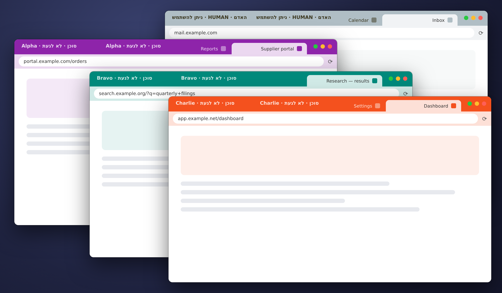
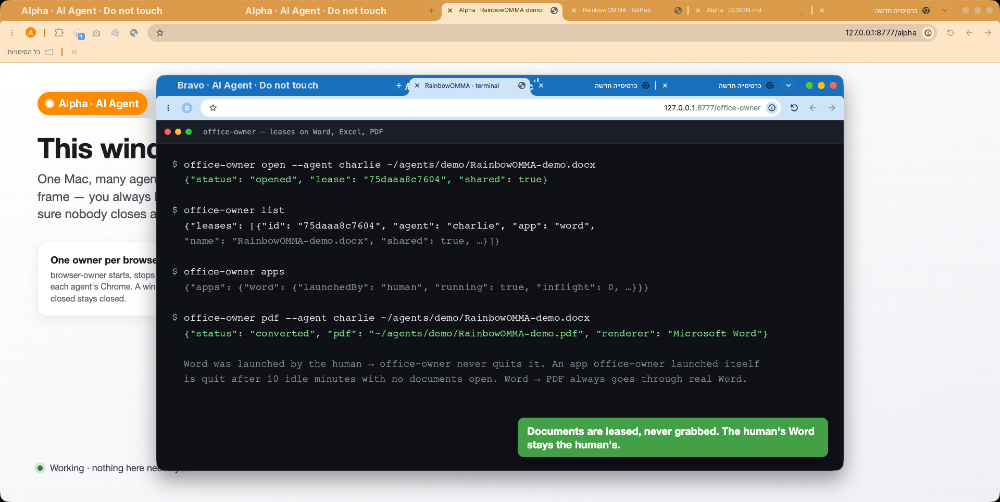
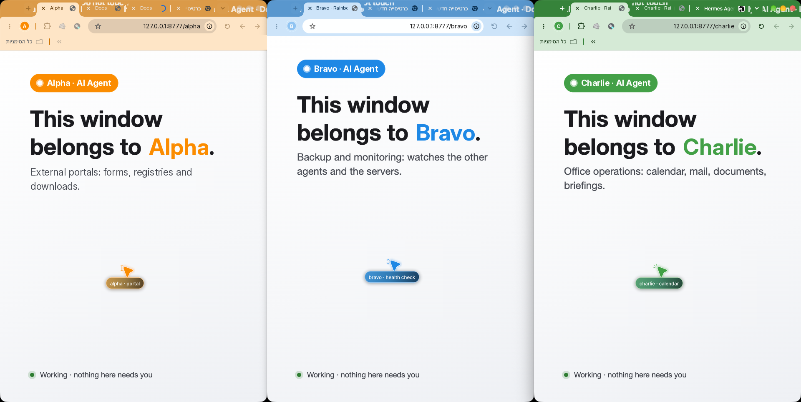
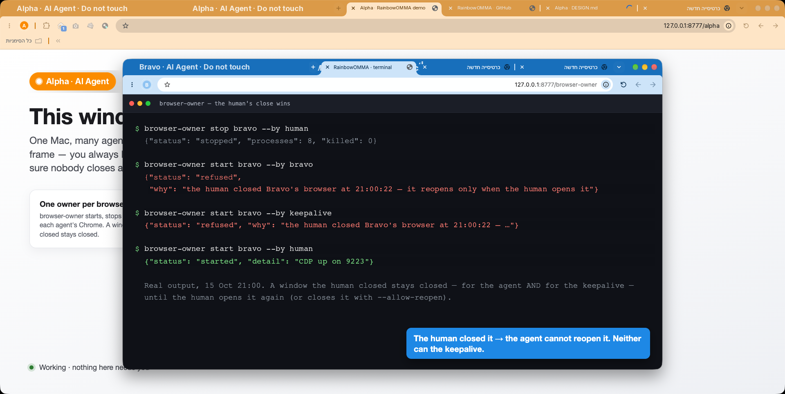
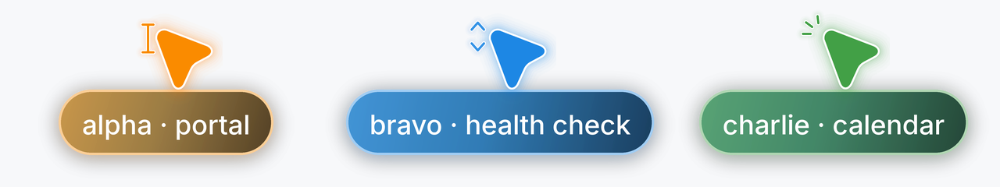
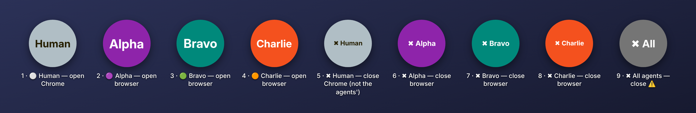

<p align="center">
  <picture>
    <source media="(prefers-color-scheme: dark)" srcset="docs/brand/header-dark.png">
    
  </picture>
</p>

<h1 align="center">One Mac, Many Agents</h1>

<p align="center">
  <a href="https://github.com/aviv27-dev/RainbowOMMA/actions/workflows/tests.yml"></a>
  <a href="LICENSE"></a>
  <a href="https://github.com/aviv27-dev/RainbowOMMA/releases"></a>
</p>

**Let a human and a whole team of AI agents share one Mac without stepping on each other.**

Your agents drive Chrome, open Word documents and fill in web portals, and you're still on the same Mac doing
your own work. RainbowOMMA keeps that arrangement civil: each agent gets **its own browser in its own color**,
one owner decides who may open or close it, and nothing an agent does can kill your browser or close a document
you're typing in.



<sub>Real screenshots from one Mac (its Chrome happens to run in a right-to-left language). Agent names are placeholders, personal details were removed, the cursors were drawn from Cua Driver's own cursor theme, and terminal output is trimmed where marked `…`.</sub>

---

## Why

Put two or three agents on one machine and the same accidents keep happening:

- **Keystrokes land in the wrong window.** macOS sees every Chrome as one app, so typing meant for your browser can end up in an agent's.
- **Agents kill each other's browsers.** Each one writes its own "keep my browser alive" or "clean up" script. A `pkill -f chrome` in one agent logs another agent out mid-task, and sometimes kills the shell that was about to relaunch it.
- **Documents close under you.** An agent that "closes the active document" in Word can close the one *you* were editing, without saving.
- **You can't tell whose window is whose.** Four identical Chrome windows, and only one of them is yours.

## What it does

RainbowOMMA has one rule: **one owner per resource; everyone else asks it.**

| Resource | Owner | What it guarantees |
|---|---|---|
| Each agent's Chrome (its own profile and DevTools/CDP port) | `browser-owner` | One lock per agent. Starting twice never opens a second Chrome. Agents can't close each other's browser. |
| Documents agents open in Word / Excel / Acrobat / Preview | `office-owner` | Per-document leases. A document is closed only if *that agent* opened it and it's saved. Word → PDF through the real Word, without touching your documents. An app is quit only if `office-owner` launched it itself. |
| Your own Chrome | **you** | Nothing here ever touches it. |

## Quick start

```bash
git clone https://github.com/aviv27-dev/RainbowOMMA.git && cd RainbowOMMA
./install.sh                                   # tools into ~/bin; add --with-sweep for the launchd document sweep
$EDITOR ~/bin/browsers.json                    # one row per agent: port, profile, color, label

~/bin/browser-owner start alpha --by alpha     # paints Alpha's browser and opens it in the background
~/bin/browser-owner list                       # who's up, blocked, hung, or closed by the human
~/bin/browser-owner stop alpha --by human      # only the human closes an agent's browser
install/make-desktop-apps.sh                   # optional: colored open/close icons on the desktop
```

The first time an agent's window opens, macOS asks once whether Terminal (or your agent) may control **System Events**.
Allow it: that is how RainbowOMMA hands the focus back to you. If you don't, everything else still works.

A row in `browsers.json`:

```json
"alpha": { "label": "Alpha", "port": 9222, "profile": "~/agents/alpha-profile", "color": "#FB8C00" }
```

Then tell each agent, in its prompt, skill or rules, to open its browser **only** through
`browser-owner start <name> --by <name>`, and to stop when the answer is `refused`, `closed-by-person`, `blocked`
or `profile-busy`. [Works with your agent](#works-with-your-agent) has ready-made guardrails for 17 agent frameworks, so an
agent can't go around this with its own `pkill`.

Documents work the same way. Tell agents to open Word, Excel and Acrobat documents only through `office-owner`:

```bash
~/bin/office-owner open  --agent alpha --app word ~/Reports/draft.docx
~/bin/office-owner close --agent alpha ~/Reports/draft.docx    # only if Alpha opened it and it's saved
~/bin/office-owner pdf   --agent alpha ~/Reports/draft.docx    # Word → PDF through the real Word
~/bin/office-owner apps                                        # which Office apps run, and who launched them
```

`pdf` converts a uniquely named copy in one fixed work folder (`~/.rainbowomma/word-convert`, or set `OFFICE_WORD_DIR`).
Word's sandbox asks permission once per folder, so **the first conversion on a new Mac shows a Word permission prompt**.
Allow it once and later conversions run without asking.



---

## Features

### 🎨 A color for every agent
Each agent's browser wears a **real Chrome theme**: the whole frame is painted in the agent's color, with its name
written across it. One look at the screen tells you whose window is in front, and your own browser can be marked
"HUMAN · free to use".



### 🧑 The human comes first
- Only the human closes an agent's browser for good. After you close it, restarts by the agent, or by any keep-alive script it runs, are `refused` until you reopen it.
- If you quit an agent's Chrome with ⌘Q, the tool remembers that and doesn't relaunch it behind your back (`closed-by-person`).
- A new agent window that takes focus hands it straight back to whatever you were using.
- An app you launched is never quit. `office-owner` quits only the apps it launched itself, after 10 idle minutes with no documents open. An app that isn't running is never launched just to check on it.



### 🛑 If in doubt, do nothing
A port that answers but isn't the agent's own browser is reported as `blocked`, not "up". A profile open somewhere
else is `profile-busy`. If the process table changes during a check, nothing is killed. Before recovering a hung
browser, the tool probes it three times over 30 seconds or more, so a Mac deep in swap doesn't lose a logged-in session.

### 🤖 Made for agents to call
Every command prints **one JSON answer** with stable status words, so an agent can branch on the result instead of
guessing. Exit codes: `browser-owner` `0` ok · `2` refused (don't retry) · `1` failed or blocked (the `status` word says
why); `office-owner` `0` done · `3` left open · `1` failure.

| Command | What it does |
|---|---|
| `browser-owner list` · `status <agent>` | who is up, `blocked`, `profile-busy`, `hung`, `down`, or closed by the human |
| `browser-owner start <agent> --by <who>` | paints and opens the agent's browser in the background; `already-up` if it runs |
| `browser-owner stop <agent> --by human [--allow-reopen]` | only the human closes it; it stays closed unless `--allow-reopen` |
| `browser-owner recover <agent> --by <who>` | restarts a hung browser after three probes; never one the human closed |
| `browser-owner idle-stop <agent> --by <who>` | closes an idle browser, only for agents with `idleMinutes` in `browsers.json`; never by another agent, never sooner than `idleMinutes` after it opened |
| `browser-owner names` · `human-theme` | the agents it may stop (for scripts) · builds the "HUMAN · free to use" theme for your own Chrome |
| `office-owner open\|close\|renew --agent <a> <file>` | leases a document, and closes it only if that agent opened it and it's saved |
| `office-owner pdf --agent <a> <file.docx> [--force]` · `apps` · `list` · `sweep` | Word → PDF (never over an existing PDF without `--force`) · which apps run and who launched them · the leases · drop stale leases and quit idle apps it launched |

### 🖱️ A cursor in the same color
When an agent drives the Mac through [Cua Driver](https://github.com/trycua/cua) computer use, its on-screen cursor
wears the agent's color too, so you can see which agent is clicking. Build and install one cursor theme per agent, then
connect your agent as shown in [Works with your agent](#works-with-your-agent).



```bash
python3 tools/cursor-themes/build_cursor_themes.py --registry ~/bin/browsers.json --install
cua-driver cursor-theme list            # com.rainbowomma.cursor.<agent> …
```

### 🌍 Left-to-right and right-to-left
Every message a person sees comes from one catalog: the `why` in each answer, notifications, desktop icon names and the
text on the frame. It ships with English (left-to-right) and Hebrew (right-to-left) and follows your Mac's preferred
language, or `RAINBOW_LANG`. The frame follows the reading direction: in a left-to-right Chrome the tabs grow from the
left, so the agent's name runs along the right part of the frame; in a right-to-left Chrome it sits on the left.
Status words and exit codes never change with the language, because agents parse them.

### 🖥️ One-click desktop controls
`install/make-desktop-apps.sh` puts colored open/close icons on the desktop for every agent in your `browsers.json`,
one pair for your own Chrome, and a "close all agents" button. Closing an agent's browser asks for confirmation first.
If you installed the tools somewhere other than `~/bin`, pass `--bin <folder>`.



---

## Works with your agent

RainbowOMMA works with any agent that can run a shell command. Two optional plug-ins go into the agent framework:

- a **guardrail**, so the agent can't go around the owner with its own `pkill`, `killall`, AppleScript `quit` or a
  Chrome started on a debug port. Every adapter points to one shared hook, `~/bin/rainbowomma-guard`, which reads each
  framework's hook payload, plus the framework's own deny list where it has one;
- the **colored cursor**, for agents that do computer use through Cua Driver over MCP: register
  `~/bin/cua-color-proxy --agent <name>` wherever the agent would run `cua-driver mcp`. The proxy passes everything
  through unchanged and gives every session the agent starts its color before the first click.

| Ready-made plug-ins | Agents |
|---|---|
| Guardrail + colored cursor | Claude Code · Codex CLI · Gemini CLI · OpenCode · Kilo Code · Qwen Code · Factory Droid · Goose · Zed · GitHub Copilot (CLI and VS Code) · Cursor · Cline · Continue |
| Guardrail + colored cursor via patch | Hermes Agent |
| Drafts, not yet verified on the real agent | Windsurf / Devin Desktop · Amp · OpenClaw |
| Colored cursor only | Warp (its denylist only asks) |

**[docs/AGENTS.md](docs/AGENTS.md)** has the table in full and the exact files and steps for each agent. For example, Claude Code:

```bash
# guardrail: merge adapters/claude-code/settings.json into ~/.claude/settings.json (fill in your home folder)
sed "s|/Users/you|$HOME|g" adapters/claude-code/settings.json
# colored cursor
claude mcp add-json --scope user cua-computer-use "{\"command\":\"$HOME/bin/cua-color-proxy\",\"args\":[\"--agent\",\"alpha\"]}"
```

Notes on the colored cursor:
- Tested with Cua Driver **0.21.0**, the version Hermes pins. Don't `cua-driver update` past the version your agent framework pins: a mismatched driver breaks computer use.
- With reduced motion on, `cua-driver serve` measured 0.0% CPU after sessions with the cursor shown.
- Claude's built-in computer use has no cursor color to set, so Claude Code gets a colored cursor only when it works through Cua Driver.
- The first action of a new session may take a moment longer: the proxy gives the session its color first.
- *Known limitation:* `cua-color-proxy` is tested against a fake driver; it hasn't run against a real Cua Driver yet.

Pattern rules only see the command text an agent runs. The owner's own checks are the real protection.

## Requirements

macOS · Google Chrome · Python 3.9+ (standard library only) · `osascript` (built in). No dependencies to install.

Optional: Microsoft Word for `office-owner pdf`, and Cua Driver for the colored agent cursor.

## Configuration

| Variable | Default | What it sets |
|---|---|---|
| `RAINBOW_LANG` | your Mac's language | `en` or `he` for every message a person sees |
| `RAINBOW_HOME` | `~/.rainbowomma` | where logs, state and themes live (`install.sh --with-sweep` hands it to the sweep job) |
| `OFFICE_WORD_DIR` | `$RAINBOW_HOME/word-convert` | the one folder Word converts in |
| `BROWSER_OWNER_REGISTRY` | `browsers.json` next to the tools | the agent registry |

## Tests

```bash
python3 tests/test_rainbowomma.py
```

The tests use a fake process table, a fake `osascript` and a fake Chrome. They never touch a real browser or app.
Building cursor themes needs a real `cua-driver`, so it's not part of the tests.

## Design

[`docs/DESIGN.md`](docs/DESIGN.md) covers the principles, every status word, and the Chrome behavior the tools rely
on, which was measured rather than guessed: how ⌘Q is told apart from a reboot, why `open -g` isn't enough to keep
focus, and how a theme is installed through the DevTools pipe on Chrome 137+.

## Roadmap

- Verify the draft adapters (Windsurf, Amp, OpenClaw) and add Kiro and Augment
- A human-activity gate that waits while you're typing
- Per-agent tab claims, an auth/login lease, and a separate Chrome channel per agent

## Contributing and security

Bug reports and pull requests are welcome: see [CONTRIBUTING.md](CONTRIBUTING.md). Every behavior change comes with a
test that uses fakes only. To report a security problem privately, see [SECURITY.md](SECURITY.md).

## License

RainbowOMMA is released under the [Apache License 2.0](LICENSE).

`tools/cursor-themes/cua.default.lottie` is Cua Driver's default cursor theme, © Cua AI, Inc., under the MIT License.
See [`third_party/NOTICE-cua.md`](third_party/NOTICE-cua.md).
