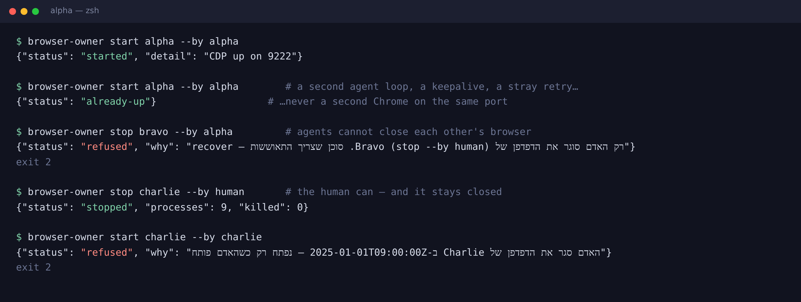

# 🌈 RainbowOMMA — One Mac, Many Agents

[](https://github.com/aviv27-dev/RainbowOMMA/actions/workflows/tests.yml)
[](LICENSE)

**Let a human and a whole team of AI agents share one Mac without stepping on each other.**

Your agents drive Chrome, open Word documents and fill in web portals, and you're still on the same Mac doing
your own work. RainbowOMMA keeps that arrangement civil: each agent gets **its own browser in its own color**,
one owner decides who may open or close it, and nothing an agent does can kill your browser or close a document
you're typing in.


<sub>Illustration of the window frames RainbowOMMA paints, shown in its Hebrew (RTL) interface. RainbowOMMA speaks English and Hebrew.</sub>

---

## Why

Put two or three agents on one machine and the same accidents keep happening:

- **Keystrokes land in the wrong window.** macOS sees every Chrome as one app, so typing meant for your browser can end up in an agent's.
- **Agents kill each other's browsers.** Each one writes its own "keep my browser alive" or "clean up" script. A `pkill -f chrome` in one agent logs another agent out mid-task, and sometimes kills the shell that was about to relaunch it.
- **Documents close under you.** An agent that "closes the active document" in Word can close the one *you* were editing, without saving.
- **You can't tell whose window is whose.** Four identical Chrome windows, and only one of them is yours.

## What it does

RainbowOMMA has one rule: **one owner per resource; everyone else asks it.**

| Resource | Owner | What it guarantees |
|---|---|---|
| Each agent's Chrome (its CDP port + profile) | `browser-owner` | One lock per agent. Starting twice never opens a second Chrome. Agents can't close each other's browser. |
| Documents agents open in Word / Excel / Acrobat / Preview | `office-owner` | Per-document leases. A document is closed only if *that agent* opened it and it's saved. Word → PDF through the real Word, without touching your documents. An app is quit only if `office-owner` launched it itself. |
| Your own Chrome | **you** | Nothing here ever touches it. |

### 🎨 A color for every agent
Each agent's browser wears a **real Chrome theme**: the whole frame is painted in the agent's color, with its name
written across it. One look at the screen tells you whose window is in front, and your own browser can be marked
"HUMAN · free to use".

### 🧑 The human comes first
- Only the human closes an agent's browser for good. After you close it, agent and keepalive restarts are `refused` until you reopen it.
- If you quit an agent's Chrome with ⌘Q, the tool remembers that and doesn't relaunch it behind your back (`closed-by-person`).
- A new agent window that takes focus hands it straight back to whatever you were using.
- An app you launched is never quit. `office-owner` quits only the apps it launched itself, after 10 idle minutes with no documents open. An app that isn't running is never launched just to check on it.

### 🛑 If in doubt, do nothing
A port that answers but isn't the agent's own browser is reported as `blocked`, not "up". A profile open somewhere
else is `profile-busy`. If the process table changes during a check, nothing is killed. Before recovering a hung
browser, the tool probes it three times over 30 seconds or more, so a Mac deep in swap doesn't lose a logged-in session.

### 🤖 Made for agents to call
Every command prints **one JSON answer** with stable status words and exit codes (`browser-owner`: `0` ok · `2` refused · `1` failure;
`office-owner`: `0` done · `3` left open · `1` failure), so an agent can branch on the result instead of guessing.



### 🖱️ A cursor in the same color
When an agent drives the Mac through [Cua Driver](https://github.com/trycua/cua) computer use, its on-screen cursor
wears the agent's color too, so you can see which agent is clicking.

```bash
python3 tools/cursor-themes/build_cursor_themes.py --registry ~/bin/browsers.json --install
cua-driver cursor-theme list            # com.rainbowomma.cursor.<agent> …
```

For Hermes Agent, apply [`adapters/hermes-cua-cursor-theme.patch`](adapters/hermes-cua-cursor-theme.patch) and add
[`adapters/hermes-cursor-config.yaml`](adapters/hermes-cursor-config.yaml) to the agent's profile.

- Tested with Cua Driver **0.21.0**, the version Hermes pins. Don't `cua-driver update` past the version your agent framework pins: a mismatched driver breaks computer use.
- With reduced motion on, `cua-driver serve` measured 0.0% CPU after sessions with the cursor shown.
- Agents on Codex aren't covered yet. The Hermes patch is Hermes-only, and a Codex adapter is future work.

### 🌍 English and Hebrew
Every message a person sees comes in English or Hebrew: the `why` in each answer, notifications, desktop icon names and
the text on the frame. The language follows your Mac's preferred language; set `RAINBOW_LANG=en` or `RAINBOW_LANG=he` to
choose. The frame follows the direction too. In Hebrew (RTL) the tabs grow from the right, so the agent's name sits on the
left. In English (LTR) the tabs grow from the left, so the name runs along the right part of the frame.
Status words and exit codes stay the same in both languages, because agents parse them.

### 🖥️ One-click desktop controls
`install/make-desktop-apps.sh` puts colored open/close icons on the desktop: one pair per agent, one for your own
Chrome, and a "close all agents" button that asks for confirmation first.


---

## Quick start

```bash
git clone https://github.com/aviv27-dev/RainbowOMMA.git && cd RainbowOMMA
./install.sh                                   # tools into ~/bin; add --with-sweep for the launchd document sweep
$EDITOR ~/bin/browsers.json                    # one row per agent: port, profile, color, label

~/bin/browser-owner start alpha --by alpha     # paints Alpha's browser and opens it in the background
~/bin/browser-owner list                       # who's up, blocked, hung, or closed by the human
~/bin/browser-owner stop alpha --by human      # only the human closes an agent's browser
install/make-desktop-apps.sh                   # optional: colored open/close icons on the desktop
```

A row in `browsers.json`:

```json
"alpha": { "label": "Alpha", "port": 9222, "profile": "~/agents/alpha-profile", "color": "#8E24AA" }
```

Then tell each agent, in its prompt, skill or rules, to open its browser **only** through
`browser-owner start <name> --by <name>`, and to stop when the answer is `refused`, `closed-by-person`, `blocked`
or `profile-busy`.

Documents work the same way. Tell agents to open Word, Excel and Acrobat documents only through `office-owner`:

```bash
~/bin/office-owner open  --agent alpha --app word ~/Reports/draft.docx
~/bin/office-owner close --agent alpha ~/Reports/draft.docx    # only if Alpha opened it and it's saved
~/bin/office-owner pdf   --agent alpha ~/Reports/draft.docx    # Word → PDF through the real Word
~/bin/office-owner apps                                        # which Office apps run, and who launched them
```

`pdf` converts a uniquely named copy in one fixed work folder (`~/.rainbowomma/word-convert`, or set `OFFICE_WORD_DIR`).
Word's sandbox asks permission once per folder, so **the first conversion on a new Mac shows a Word permission prompt**.
Allow it once and later conversions run without asking.

## Guardrails for your agent framework

A guardrail stops an agent from going around the owner with its own `pkill`, `killall` or AppleScript `quit`:

- **Hermes Agent:** a ready-made deny list in [`adapters/hermes-approvals-deny.yaml`](adapters/hermes-approvals-deny.yaml).
- **Claude Code:** a ready-made PreToolUse hook in [`adapters/claude-code/`](adapters/claude-code/). Install it like this:
  ```bash
  mkdir -p ~/.claude/hooks && cp adapters/claude-code/rainbowomma-guard.py ~/.claude/hooks/
  ```
  Then merge [`adapters/claude-code/settings.json`](adapters/claude-code/settings.json) into `~/.claude/settings.json`,
  or into a project's `.claude/settings.json`. A blocked command tells the agent to use `browser-owner` instead.
- **Codex CLI:** the patterns are in [`docs/DESIGN.md`](docs/DESIGN.md#5-agent-adapters-the-guardrails). A ready-made adapter is on the roadmap.

Pattern rules only see the command an agent runs directly. The owner's own checks are the real protection.

## Requirements

macOS · Google Chrome · Python 3.9+ (standard library only) · `osascript` (built in). No dependencies to install.

Optional: Microsoft Word for `office-owner pdf`, and Cua Driver for the colored agent cursor.

## Configuration

| Variable | Default | What it sets |
|---|---|---|
| `RAINBOW_LANG` | your Mac's language | `en` or `he` for every message a person sees |
| `RAINBOW_HOME` | `~/.rainbowomma` | where logs, state and themes live (`install.sh --with-sweep` hands it to the sweep job) |
| `OFFICE_WORD_DIR` | `$RAINBOW_HOME/word-convert` | the one folder Word converts in |
| `BROWSER_OWNER_REGISTRY` | `browsers.json` next to the tools | the agent registry |

## Tests

```bash
python3 tests/test_rainbowomma.py
```

The tests use a fake process table, a fake `osascript` and a fake Chrome. They never touch a real browser or app.
Building cursor themes needs a real `cua-driver`, so it's not part of the tests.

## Design

[`docs/DESIGN.md`](docs/DESIGN.md) covers the principles, every status word, and the Chrome behaviour the tools rely
on, which was measured rather than guessed: how ⌘Q is told apart from a reboot, why `open -g` isn't enough to keep
focus, and how a theme is installed through the DevTools pipe on Chrome 137+.

## Roadmap

- A ready-made Codex CLI guardrail and cursor adapter
- A human-activity gate that waits while you're typing
- Per-agent tab claims, an auth/login lease, and a separate Chrome channel per agent

## License

RainbowOMMA is released under the [Apache License 2.0](LICENSE).

`tools/cursor-themes/cua.default.lottie` is Cua Driver's default cursor theme, © Cua AI, Inc., under the MIT License.
See [`third_party/NOTICE-cua.md`](third_party/NOTICE-cua.md).
